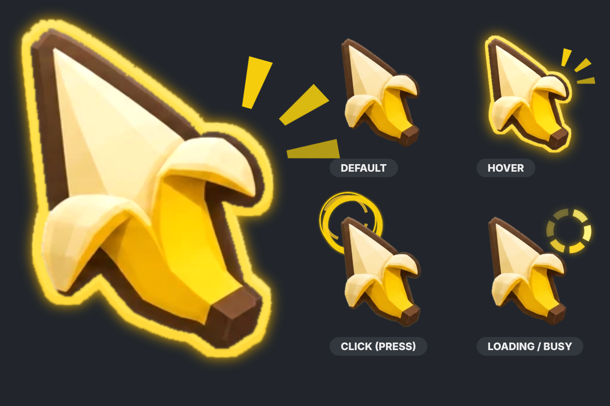
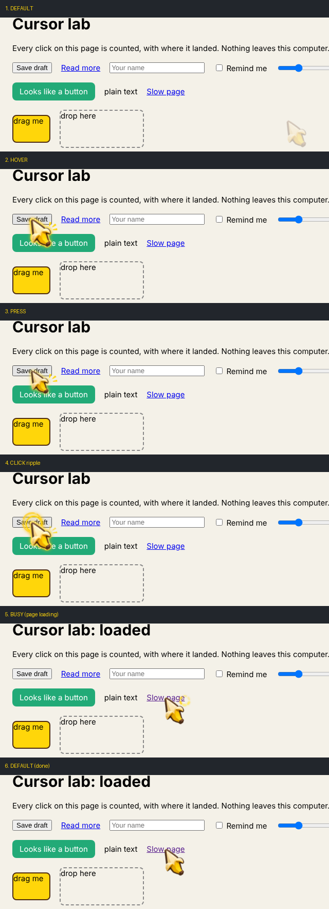

# Monkey's banana cursor

A Roblox-style low-poly banana pointer that shows **where Monkey is clicking** while he controls something. It is
feedback only: it never decides, never moves a click, takes no mouse events, and never replaces the Windows mouse.

## The asset

| | |
|---|---|
| Source of truth | `monkey/automation/cursor/banana_sprite.png`: the DEFAULT cursor **isolated from the owner's reference sheet, original pixels** (203×276, transparent, edge-decontaminated). Every state is this same image plus effect layers. `banana.svg` (a hand-built vector) is the fallback only. |
| How it was made | `python -m tools.cursor.fidelity extract` (mask, decontaminated alpha, hotspot), then `promote`. See [REFERENCE-ANALYSIS.md](REFERENCE-ANALYSIS.md) and the comparison sheets in `fidelity/`. |
| Hotspot | `manifest.json → sprite.hotspot` = pixel (14, 6) of the sprite: the opaque pixel furthest toward the top-left (the sharp tip), **measured**, never the image centre. The vector's is `hotspot` (7.56, 4.44) in its 128-unit viewBox. |
| Derived files | `png/{default,hover,pressed,busy}_{32,48,64,96}.png`: transparent, rendered by the real controller, used by the Windows desktop overlay. Rebuild with `node tools/cursor/build_assets.js` after editing the SVG. |
| Why vector + CSS effects | Crisp at every DPI and size, about 4 KB, a single geometry so the proportions can't drift between states, GPU-composited transforms, and no renderer running while hidden. A Three.js model was rejected for a 48 px pointer: it needs a WebGL context per surface and reads worse at that size. |

**Fidelity.**
- **DEFAULT** is the reference's own pixels: silhouette IoU 0.99 and SSIM about 0.98 against the reference at 32–128 px.
- **Effects** (hover contour, glow and rays; click rings and arcs; busy ring) were measured from the reference and rebuilt as independent layers. They're close, not 1:1. The remaining differences are listed in REFERENCE-ANALYSIS.md.
- **No Blender model:** the original art is sharper than any re-model at cursor sizes. That's deferred until peel animation is wanted.

## States (`banana_cursor.js`)

| State | Look | Trigger (real events only) |
|---|---|---|
| DEFAULT | Plain banana | Idle between actions |
| HOVER | Bright golden outline and glow; 3 rays for about 0.7 s; scale 1.035 | The target's **accessibility role** is interactive (button, link, textbox, checkbox, radio, combobox, menuitem, tab, slider, switch, option…). Never inferred from looks: a green div that only looks like a button gets no glow. |
| PRESS | Squash 0.9 × 0.86 around the **tip** (no drift), 70 ms | Right before the real click |
| Click ripple | Gold ring plus dashed outer ring from the tip, 320 ms | Right after the real click, at the same point |
| BUSY | Segmented golden ring spinning near the banana | Waiting on the page: navigation, a click's result, the task's WAITING state |
| Thinking | Warm pulse | Task VERIFYING / Claude deciding |
| Typing | ⌨ badge | `fill()` into a permitted field |
| Waiting for you | "✋ your turn" badge | Task NEEDS_INPUT (an answer, attestation, sign-in or approval) |
| Paused | Dimmed, "❚❚" | Task PAUSED |
| Blocked | Amber "!" | Task BLOCKED |
| Error | Small shake, red "✖" | Task FAILED |
| Success | Green "✓" and a few sparkles | Task COMPLETED (verified) |
| Drag | Tilts −9° and follows the path | `dragTo` |

Timings: press 70 ms, release 110 ms, ripple 320 ms, glow in 130 ms, glow out 170 ms. Travel is `70 + 7·√distance` ms,
capped at 260 ms, with the same formula in JS and Python. Animation is time-based (correct at any frame rate). The rAF
loop runs only while the banana is travelling; effects are CSS animations removed when done. Reduced motion (or
Windows "Show animations" off, under "Follow Windows") jumps instead of flying and drops ripples and rays.

## Three kinds of pointer (never mixed up)

1. **Browser automation pointer (implemented).** Playwright clicks inside Monkey's own browser without moving the
   Windows mouse. So the banana is drawn **inside that browser's viewport**:
   - it lives in a fixed `<monkey-cursor>` layer with a *closed* shadow root, `pointer-events: none` and `aria-hidden`;
   - it's injected with `add_init_script`, so every page gets one;
   - it's absent from the accessibility outline Monkey and Claude read.

   `BrowserSession._cursor_click` runs these steps:
   - a Playwright trial click (visible, stable, enabled, actually hit, scrolled into view);
   - travel;
   - hover;
   - press;
   - `page.mouse.click(x, y)` at the **same viewport point**;
   - ripple.

   Events are tagged `space: "viewport"`.
2. **Physical desktop pointer (Windows, `cursor_native.py`).** For desktop actions that really move the OS mouse
   (UI Automation's `click_input` fallback):
   - It's a tiny native layered window with per-pixel alpha that sits beside the real pointer:
     - `WS_EX_LAYERED` and `WS_EX_TRANSPARENT` make it click-through;
     - `WS_EX_NOACTIVATE` and `WS_EX_TOOLWINDOW` mean it never takes focus and has no taskbar button;
     - `WS_EX_TOPMOST` keeps it above the app;
     - `WDA_EXCLUDEFROMCAPTURE` keeps it out of screenshots.
   - It's scaled by the monitor's DPI.
   - The system cursor is never hidden, so a crash leaves nothing to restore: the window dies with Monkey's process.
   - Events are tagged `space: "screen"`.
3. **Presentation only.** UI Automation `invoke()` activates a control with no pointer at all. The banana points at that
   control's centre (the control being activated) and makes no claim that the mouse moved.

## Coordinates (`cursor_events.py`, `desktop.py`)

| Space | Used by | Why it stays aligned |
|---|---|---|
| `viewport` (CSS px) | Playwright clicks plus the in-page banana | Both are in the same space. Device-pixel ratio, browser zoom, CSS zoom and scrolling cancel out. Tested at DPR 1, 1.25, 1.5 and 2, with `body.zoom` 1.5, and after scrolling 900 px: tip and ripple within **1 px** of the trusted click. |
| `screen` (physical px) | Windows overlay, UI Automation rects | The process is per-monitor DPI aware. Negative coordinates work on left/upper monitors. The banana window goes at `(x, y) − tip`. |
| Model screenshot | Claude's computer/browser tools | `ScreenMap.fit/to_screen/to_image` (resize and round-trip tested), plus `logical_to_physical` for DPI-unaware APIs. |

If the banana hasn't finished travelling when the click fires (a slow frame), `press()` **snaps it to the target first**,
so a press or ripple is never drawn anywhere but where the click lands.

## Settings

Settings → Look & mic → **Animated banana cursor**:
- Show it: Off, or On while Monkey controls something (the default).
- Size, Glow, Animation (Follow Windows / Full / Reduced).
- Click ripples, and a loading ring.
- A **live preview** with a demo and buttons for every state. It needs no computer-control permission.

"Always on" isn't offered: Monkey only has a pointer while he's acting. Showing a banana over your own mouse would
mean replacing the Windows cursor system-wide, which isn't reliable to restore and could confuse whose mouse is whose.

## Tests

- `tests/test_banana_cursor.py` (12 tests, headless Chromium; on CI's Windows job, Edge):
  - real trusted clicks executed;
  - tip and ripple at the click point at 4 DPRs plus page zoom and scrolling;
  - hover only for interactive roles;
  - busy during a slow page;
  - 6 rapid clicks counted exactly once each, and effects cleaned up;
  - reduced motion and every badge;
  - JS and Python travel-time parity;
  - invisible to `elementFromPoint` and to the accessibility outline.
- `tests/test_automation_desktop.py`:
  - native overlay placement maths;
  - **on Windows**: the window has the click-through, no-focus and topmost styles; the tip pixel is exactly on the action point; `WindowFromPoint` passes through it; hide works.
- `tests/test_automation_e2e.py`: a full course run **with the cursor on** (expire + flaky + rerender variants).
- `python -m tools.cursor.demo`: the demonstration above (verified click plus slow-page load). Its output is `demo-strip.png`.

## Performance

| | |
|---|---|
| Visual time added per click | Travel ≤ 260 ms plus press ≤ 90 ms (measured 0.35–0.41 s including hover in the demo). Reduced motion: about 0 ms. |
| Whole course | See the evaluation table in `docs/COMPUTER-AGENT.md` (runs with the cursor on vs off). |
| CPU/GPU while idle | 0. No animation loop runs when the banana isn't moving; CSS keyframes run only during effects; the native overlay sleeps on its queue (50 ms poll) and redraws only while animating. |
| Not measured | GPU use on the Dell: needs the Windows machine (procedure in `docs/COMPUTER-AGENT.md`). |

## Limitations / unverified

- The Windows native overlay has only been run in CI's headless Windows session (styles, alignment, click-through),
  not yet watched on the owner's monitors. Real-DPI rendering quality there is unverified.
- Desktop tasks don't run through the TaskManager yet (window control is a tested driver), so the native banana
  appears only when the desktop driver is used directly.
- Hand-built vector art: close to the reference's style, not identical (see the fidelity note above).
