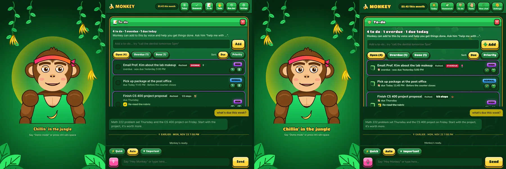
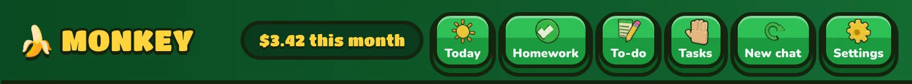
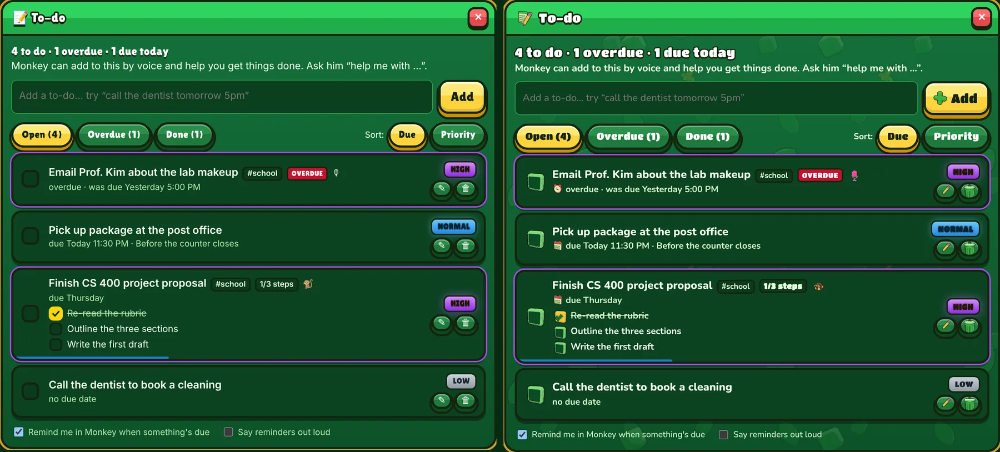
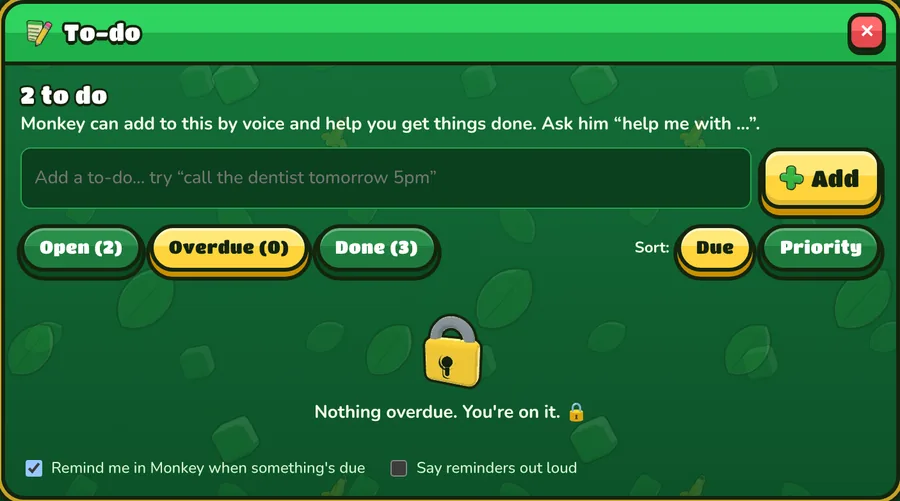

# Toy-block 3D icons and backgrounds

*2026-11-23, branch `feature/todo-blocky-ui`.* The owner asked for "3D Roblox-style animated UI prototypes for all
icons and backgrounds", and for one approach to be researched and used in the to-do panel. This is an **original**
style in that spirit: chunky, bevelled, toy-like blocks with bouncy motion, in Monkey's jungle palette. No logos,
characters, fonts or assets from Roblox or any other game, and no copy of any game's UI.

- **Gallery:** `ui/prototypes/blocky-icons/` (`cd ui && npm run dev`, open `/prototypes/blocky-icons/`;
  `?baked` starts in sprite mode). Not part of the production build (Vite only builds `ui/index.html`).
- **Fonts for the same panel:** [TODO-FONTS.md](TODO-FONTS.md).
- **Code:** `ui/src/blocky/` (kit, recipes, clips, baker, sprite player, `skin.ts` = shared bake/cache/playback),
  `ui/src/todo-blocky.ts` (to-do panel), `ui/src/nav-blocky.ts` (header buttons + mic), and one CSS file,
  `ui/src/theme-blocky.css` (fonts, small-text rules, icon sprites, panel). Hooks into existing code: one
  `decorate(root)` call at the end of `todo.ts`'s `draw()`, `initNavIcons()` at the end of boot and
  `<html data-juice>` in `applyLook` (`main.ts`).
- **Scope with the motion work** (`feature/ui-motion`): animations here are only the icons' own hover / press / pop
  frames, the check button's overshoot and the panel background's one fade-in.

## The look

Every icon is a procedural three.js model (`ui/src/blocky/icons.ts`) built from a small kit (`kit.ts`):

- **Shapes:** rounded boxes, rounded-rim pucks (lathe), tubes, balls, and SVG paths extruded into bevelled slabs
  (a 30-line path parser instead of three's 60 KB SVGLoader).
- **Shading:** `MeshToonMaterial` with a 3-step gradient (shadow / mid / lit) plus a stepped **rim light** injected
  into the shader, so edges read as glossy plastic.
- **Outline:** an ink-coloured inverted hull (back faces pushed out along merged smooth normals), matching the
  app's 3 px ink outlines.
- **Motion** (`anim.ts`, shared by live rendering and baking): idle bob and sway; **hover** = crouch, hop, wiggle,
  squash on landing; **press** = squash; **pop** ("done!") = overshoot 0.55 → 1.24 → 0.94 → 1 with one full spin.
  Icons add their own touches: the trash lid lifts, the alarm clock rattles, the gear and sun turn, the check mark
  pops in, the padlock shackle opens.

## Inventory (what the UI uses today)

**63 icons + 6 backgrounds**, from a scan of `ui/src` and `ui/index.html` for emoji, symbols, inline SVG and
background images (text arrows such as → ≈ ≥ ↑ are typography, not icons). The full table with each icon's source
glyph and call sites is `INVENTORY` / `BACKGROUNDS` in `ui/src/blocky/icons.ts` and the gallery renders all of it.

| Group | Count | Icons |
|---|---|---|
| To-do panel | 11 | checkbox open, checkbox done (☑ ✓ ✅), add (+), edit ✎, delete 🗑, due 📅, reminder/overdue ⏰, Monkey 🐒, locked-in 🔒, banana 🍌, warning ⚠ |
| Header & composer | 13 | to-do 📝, lab 🧪, today ☀, homework ✓, tasks 🖐, health ♥ ❤️, new chat ⟲, settings ⚙, close ✕, mic 🎙, listening 👂, quick ⚡, important ★ ☆ |
| Cards & messages | 16 | generated ✨, image 🖼, what matters 📋, email list 📥, draft ✉️ 📧, weather 🌤️, sources 🔎, clean up 🧹, Canvas 🎒, school 🏫, benchmark 📊, history 🗂, brain 🧠, voice lines 🗣, voice preview 🔊, download ⬇ |
| Status pops | 5 | talk soon 👋, stopped ✋, didn't catch ❓, all good 👍, thinking 💭 |
| Computer tasks | 15 | browser 🌐, windows 🪟, visual 👁, switched ↪, waiting ⏳, plan 🧭, needs you 🙋, done 🎉, stop ■, pause ⏸, play ▶, retry ↻, failed ✗, bigger ⤢, computer action 🖥 |
| Small marks | 3 | unread ●, music note ♪ (already 3D in the avatar VFX), folded-card caret ▸ |
| Backgrounds | 6 | stage glow (`#stage`), jungle vines/leaves/bananas (`jungle.ts`), side-panel leaf tile (`#side`), card/panel fill (`.card`, the to-do panel), header strips, dialog/toast fill |

Some icons cover several glyphs (✉️ and 📧 share the envelope; ✓ ☑ ✅ share the done checkbox).

Gallery (sprite mode, demo data): [img/icon-gallery.webp](img/icon-gallery.webp).

## Four ways to build them (compared in the gallery)

| | **A. Live 3D, one shared canvas** | **B. Baked sprites (three.js once → sheet)** | **C. CSS + layered SVG** | **D. Blender, offline** |
|---|---|---|---|---|
| How | One fixed transparent WebGL canvas over the page; each icon drawn into its element's rectangle (scissor) | The same models and clips rendered once by a short-lived renderer into a sprite sheet at the screen's DPR; CSS `background-position` frames (Web Animations API, `steps()`) | Hand-drawn SVG with an offset "lip" layer and highlight; CSS transform keyframes | `tools/blender/blocky_icons.py`: Cycles, bevel modifiers, plastic coat, Freestyle outline; PNG/WebP strips |
| Look | Best interactivity (any angle, any timing) | **Identical frames to A** (same renderer) | Flat 2.5D; the spin reads as a flipping card | Richest materials (soft shadows, real bevels) |
| WebGL contexts | 1 for the whole page, **always on** while anything animates | **0 at runtime**; 1 for a moment while baking, then disposed (`forceContextLoss`) | 0 | 0 |
| Frame cost (measured, software GL) | 31 icons on screen idling: CPU 5 ms/frame p50, 51 ms p95, ~6 fps reached; stops when idle is off | Nothing at rest; a few small repaints during a 0.15–0.7 s clip | Nothing at rest; style + paint during clips | Same as B |
| One-time cost | Shader compile on first frame | Panel set (10 icons, 193 frames at 32 px + 3 empty-state heroes at 72 px + 2 tiles): **7.5–13 s on software GL** in this container; then **0.7–0.9 s** to icons on later launches (cached) | none | Offline: 23–34 s per 18-frame clip at 192 px, 16 samples, 4 CPU cores |
| Bytes shipped | ≈ code only (kit + recipes + baker ≈ 70 KB in the single-file build, three.js already bundled) | Same code; the sheets are generated on the PC (panel: 362 KB WebP incl. tiles, kept in localStorage), not shipped | 3.2 KB for 4 icons | 40–50 KB WebP per icon per clip at 2x (178 KB for 4 icons × 1 clip; the whole inventory × 3 clips would be ≈ 8 MB) |
| Crisp at 1x / 2x | yes (renders at DPR) | yes (baked at the actual DPR; 2x supersampled at 1x) | yes (vector) | only at the rendered size |
| Reduced motion | stop the loop, draw the rest pose | don't play clips; rest frame | drop the keyframes | rest frame |
| Change a colour or add an icon | edit a recipe | edit a recipe (bump `VERSION`) | redraw by hand | re-model and re-render |

**Why not A in the app:** the lag audit (`docs/LAG-AUDIT.md`) already counts the avatar's WebGL as the main GPU cost
and the companion window doubles it; a second always-on canvas would add per-frame GPU work for the whole time the
panel is open, and per-icon canvases (a dozen contexts) are out of the question. **Why not D:** best materials, but
an offline pipeline per change, big bitmaps for every size × DPR × clip, and Blender is only available in some
sessions. **Why not C alone:** cheapest and crisp, but it doesn't read as 3D (no lighting change as things turn), which
is the point of the request; it remains the fallback look (the panel keeps its SVG checkbox when there is no WebGL).

## Recommendation: B, baked sprites, rendered on the owner's PC

Same look as live 3D, zero WebGL and zero work at rest, no image bytes in the installer, crisp at the real DPR, and
one source of truth (the recipes) for every size. It is implemented in the **header** (Lab, Today, Homework, To-do,
Tasks, Health, New chat, Settings: hop on hover, squash on press; the gear and sun turn, the new-chat arrow spins),
the composer's **mic**, and the **to-do panel**:

| Element | Icon | Motion |
|---|---|---|
| Checkbox (rows and sub-steps) | open: light-green block with a recess; done: banana block with a green check | hover hop, press squash, **"done!" pop** (check flies in, block spins, button overshoot) + the existing burst and "+1 🍌 NICE!" |
| Add button | green plus block | hover hop with a quarter turn; occasional hop at rest (full Juice) |
| Edit / Delete | pencil / green bin | pencil scribble, **bin lid lifts** |
| Due line | calendar block; alarm clock on overdue rows | hover |
| Source badge | mic (voice) / Monkey head | hover |
| Panel title | notepad with pencil | hover |
| Empty states | banana bunch (open), padlock (nothing overdue), empty box (nothing done) at 72 px | hop on hover; banana/Add hop every 8–12 s at full Juice |
| Background | two baked tiles of chunky leaf blocks and cubes (12% and 18% opacity) behind the content | one fade-in when the panel opens; static at rest |

**Rules the layer follows** (`ui/src/todo-blocky.ts`):
- Decorates after each `draw()`; never changes behaviour, text or accessible names (icons are `aria-hidden`; buttons keep
  their `aria-label`; source badges get `role="img"` + their title).
- **Juice:** `main.ts applyLook` now also sets `<html data-juice>`. *Full*: everything; *calm*: no ambient hops;
  *minimal* or `prefers-reduced-motion`: static icons, no clips, no fade-in, no pop.
- **Software GL** (SwiftShader / llvmpipe / WARP, e.g. Remote Desktop or CI): the bake is skipped and the panel keeps
  its normal look; `?blocky` forces it (tests, measurements). A sheet cached earlier on a GPU is still used.
- The bake yields every 6 frames and between icons, compiles shaders with `compileAsync`, and copies one row chunk per
  readback (not one GPU stall per frame).
- Cached in `localStorage` per DPR (`monkey.blocky.v<VERSION>.<dpr>`, older versions removed); bump `VERSION` in
  `blocky/skin.ts` when a recipe changes. One sheet: 18 rows × 20 frames of 32 px icons (the check-off "pop" has its
  own row so the other rows stay narrow), plus 3 empty-state heroes at 72 px and 2 background tiles.
- **When it bakes:** a cached sheet applies at start-up; a first bake starts at an idle moment 3 s after start-up
  (or when the to-do panel opens), so it never competes with the avatar's own start-up.

**Tried and dropped:** pointer parallax on the panel background. Moving two panel-sized layers re-rasterized them on
every move and invalidated the whole card's style (custom properties on the card): long frames while hovering went
from 23 to 41 in the first measurement. It stays in the gallery's background prototypes.

## Backgrounds (gallery)

| Prototype | How | Cost | Verdict |
|---|---|---|---|
| A. Voxel canopy | Two seamless tiles baked with three.js (orthographic, top-down; pieces crossing an edge are drawn on both sides), 17 KB WebP, CSS transform drift + pointer parallax | bake 1.8 s on software GL; then compositor only | **Used in the panel, static** |
| B. Layered SVG leaves | Hand-drawn SVG tiles with the same lip-shadow trick, 3 KB | none | flatter; good no-WebGL fallback |
| C. Live floating blocks | 16 rotating blocks/leaves in the shared live renderer at a 30 fps cap | constant GPU/CPU (2.4 ms CPU/frame p50 in software GL, every frame) | prettiest; too costly behind text all day |

## Measured cost in the app (Playwright, `?demo&svg&blocky`, cloud container, software GL)

"Before" is `main`, "after" is this branch (app-wide fonts + header, mic and panel icons), same script
(`TaskDuration` from CDP `Performance.getMetrics`, main-thread task time per second), on a quiet container (load
average 1.5–3 on 4 cores). An earlier run during heavy load (13–37) showed the same picture with 2–3× the noise.

| | Before | After |
|---|---|---|
| Idle, to-do panel open (ms/s, 3 × 8 s) | 94 / 99 / 103 | 88 / 91 / 98 |
| Idle, panel open, Juice calm | 90 | 98 |
| Idle, panel closed | 80 | 96 |
| Running animations in the panel at rest | 0 | **0** (the app's other 6 running animations unchanged) |
| Hovering 9 controls + checking one off (ms/s) | 124 | 180 (sprite frames repaint while a clip plays) |
| Frames during that interaction: p50 / p95 / over 50 ms | 16.7 / 16.7 ms / 0 | 16.7 / 16.8 ms / 1 |
| First bake (all icons, heroes, tiles) on software GL | — | 4.3–6.0 s; longest task 206 ms (icons 3.1 s, heroes 0.9 s, tiles 0.3 s) |
| Later launches: panel open → icons (cached sheet, no WebGL) | — | 0.36 s |
| Generated sheet + tiles (WebP, kept in localStorage, not shipped) | — | 526 KB |
| `index.html` (single file) | 990.9 KB | ≈ 1,133 KB (+66 KB fonts as base64, +≈ 76 KB code) |

Idle cost stays within run-to-run noise and nothing runs at rest; interacting costs some extra main-thread time while
a clip plays, without dropped frames. **Not measured: the Dell.** The bake's GPU time on the XPS 15 (Intel iGPU or
RTX) should be a small fraction of software GL's, but that needs a real run: read `window.__monkeyBlocky()` in
DevTools (`bakeMs`, `phases`).

## Next steps if the owner likes it

1. Check it on the Dell (bake time, crispness at 125–150% scaling, Juice levels).
2. Same approach for the card titles and status pops (more rows in the same sheet).
3. Pre-bake at idle a few seconds after start-up, so even the first panel open shows icons immediately.
4. Tune shapes the owner doesn't like (the banana bunch is the weakest model).
