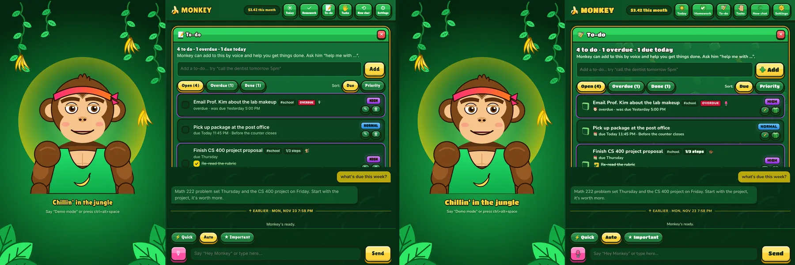
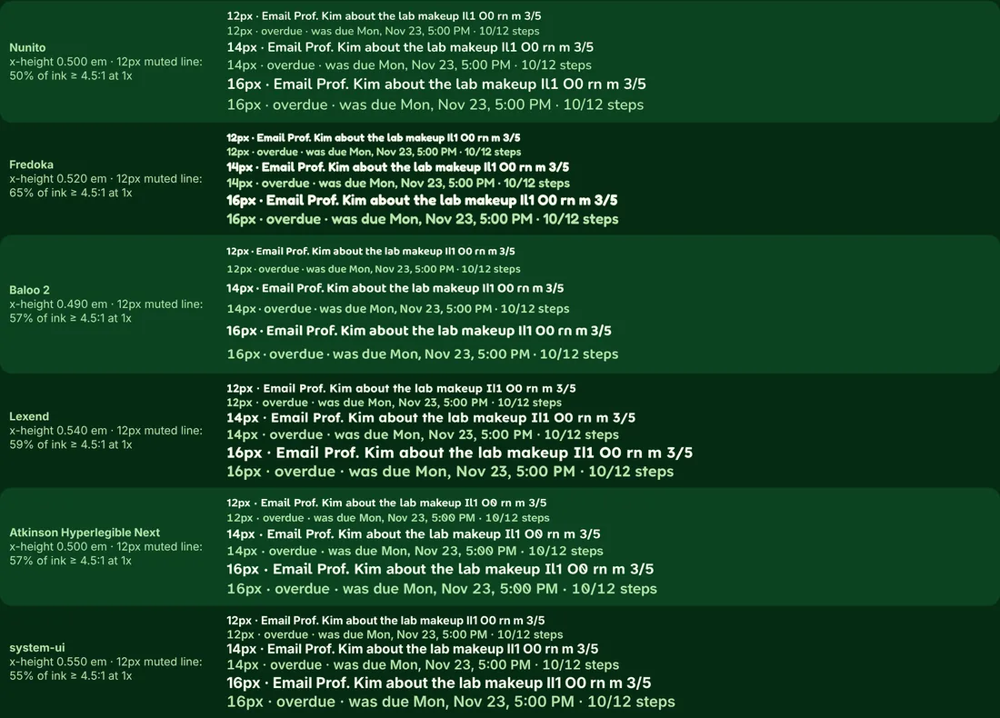

# App fonts (chosen on the to-do panel)

*2026-11-23, branch `feature/todo-blocky-ui`.* The owner asked for "more artistic and fitting fonts for the app's art
style while still being readable". The pairings were compared on the to-do panel (dense, small text: the hardest
case) and the pick is applied **app-wide**: headings, buttons, panels, chat, settings. Comparison page: `ui/prototypes/fonts/`
(`cd ui && npm run dev`, open `/prototypes/fonts/`). It renders the **real** panel (`renderTodos` with the app's CSS)
once per pairing and measures every face live.

## Pick: Titan One (display) + Nunito (text)

| Role | Font | Licence | Source | Shipped as |
|---|---|---|---|---|
| Headings, buttons, tabs, badges, counters | **Titan One** 400 | SIL OFL 1.1 (Reserved Font Name "Titan One"; we ship the file unmodified) | Rodrigo Fuenzalida, via Google Fonts / `@fontsource/titan-one` 5.3.0 | `ui/src/fonts/titan-one-latin-400-normal.woff2` (10.5 KB) |
| Task titles, due dates, steps, inputs, hints | **Nunito** variable (200–1000) | SIL OFL 1.1 | The Nunito Project Authors (github.com/googlefonts/nunito), via `@fontsource-variable/nunito` 5.3.0 | `ui/src/fonts/nunito-latin-wght-normal.woff2` (38 KB) |

- Both are bundled: the build inlines them into `index.html`, so pywebview never needs a CDN. Latin subset only;
  other scripts fall back to Segoe UI. Licence texts: `ui/src/fonts/OFL-*.txt`; listed in `THIRD_PARTY_NOTICES.md`.
- Applied app-wide in `ui/src/theme-blocky.css` (section 1): `--display` is Titan One (it was Lilita One) and the body
  is Nunito 600 (it was Segoe UI 400). Lilita One stays bundled only for the avatar's canvas VFX text (`avatar/vfx.ts`,
  left to the motion work).
- **Small-size rule** (section 2): the display face is used only at 12 px and up. Header button labels (10 px),
  priority badges (11 px) and the OVERDUE flag use Nunito 900 instead; counts use tabular figures; the settings
  title no longer gets a faux bold. `tests/test_todo_ui.py::test_display_face_is_never_used_below_12px` scans the
  header, chat, to-do panel, Today and Settings for display-face text under 12 px.
- The other candidates are `devDependencies` used only by the comparison page; they are not shipped.

## What was compared

Five-plus-one pairings, all OFL or Apache 2.0:

| Pairing | Display licence | Text licence | Character |
|---|---|---|---|
| Lilita One + Nunito | OFL | OFL | today's display face, rounded text |
| **Titan One + Nunito** | OFL | OFL | rounder, heavier "toy block" display |
| Titan One + Fredoka | OFL | OFL | everything rounded, the most toy-like |
| Luckiest Guy + Baloo 2 | Apache 2.0 | OFL | comic-book caps, soft text |
| Bungee + Lexend | OFL | OFL | blocky signage caps (most "voxel"), reading-proficiency text |
| Rowdies + Atkinson Hyperlegible Next | OFL | OFL | heavy rounded display, low-vision-research text |

## Measurements (cloud container, Chromium, grayscale anti-aliasing)

**Text faces** at the weight the panel uses (700). "Solid ink" = share of the glyph pixels that reach 4.5:1 against
the row background (`#0b4321`) when rendered small; thin strokes at 12 px are mostly anti-aliased edge pixels, so this
is where faces differ even though their nominal colour contrast is identical.

| Text face | x-height (em) | x/cap | width (em/char) | tabular figures | solid ink, title 12 px @1x | @2x | solid ink, muted line 12 px @1x (600 / 700) |
|---|---|---|---|---|---|---|---|
| Nunito | 0.50 | 0.69 | 0.484 | yes | 73% (800: 79%) | 84% | 50% / 56% |
| Fredoka | 0.52 | 0.74 | 0.456 | **no** | 81% | 87% | 65% / 70% |
| Baloo 2 | 0.49 | 0.79 | 0.454 | yes | 77% | 84% | 57% / 62% |
| Lexend | 0.54 | 0.77 | 0.534 | no | 75% | 86% | 59% / 63% |
| Atkinson Hyperlegible Next | 0.50 | 0.75 | 0.496 | yes | 75% | 85% | 57% / 58% |
| system-ui (container fallback) | 0.55 | 0.75 | 0.503 | yes | 71% | 87% | 55% / 59% |

**Display faces**: x-height / cap height: Lilita One 0.51 / 0.71, **Titan One 0.58 / 0.71**, Luckiest Guy 0.70 / 0.71
(all caps), Bungee 0.72 / 0.72 (all caps, widest at 0.595 em/char), Rowdies 0.48 / 0.71.

**Contrast of the panel's colour pairs** (WCAG 2, font-independent):

| Text | Ratio | |
|---|---|---|
| Task title `#f6ffe9` on row `#0b4321` | 11.1 : 1 | AA |
| Due line / steps (muted) on row | 7.9 : 1 → **9.7 : 1** with the panel's brighter muted `#d6f5cb` | AA |
| Hint text (muted) on the panel's lightest green `#14713a` | 4.2 : 1 (**fails AA at 12 px**) → **5.2 : 1** | fixed in the skin |
| OVERDUE flag (white on `#c8102e`) | 5.9 : 1 | AA |
| Button label (ink on banana) | 11.4 : 1 | AA |
| Tab label (white on leaf `#1f7a3c`) | 5.4 : 1 | AA |
| Header ink outline on the header strip | 5.6 : 1 | outline counts as the text colour |

All six pairings on the real panel: [img/font-pairings.webp](img/font-pairings.webp).

## Why this pair

- **Titan One** reads as a chunky, soft plastic toy, which is the 3D block look of the new icons, more than Lilita
  One's condensed poster style. Its x-height (0.58 em) is the largest of the mixed-case display faces, so tabs, badges
  and the `1/3 steps` counter stay legible at 12–14 px. Luckiest Guy and Bungee are all caps: fine for a title but
  shouty and wide in tabs ("OVERDUE (1)"), and Bungee is the widest.
- **Body weight 600** (not 400/500): Nunito's regular is thin on the dark greens at 12 px; 600 keeps hints and meta text
  sturdy, and chat messages use 550.
- **Nunito** has rounded terminals that match Titan One, open counters, a full weight range and **tabular figures**
  (due times and counts don't jitter). Its one weakness, lighter strokes at 12 px, is fixed by using weight 800 for
  titles and 700 for due lines and steps (title solid ink 73% → 79%, as good as Fredoka) and the brighter muted colour.
- **Runner-up: Fredoka.** The most playful and the best small-size stroke contrast, but it is narrow and tight at 12 px
  and has no tabular figures. Lexend and Atkinson are the most "neutral readable" but look like productivity apps,
  not a jungle game. Atkinson is the best at telling I / l / 1 and 0 / O apart; if the owner ever finds titles
  ambiguous, it is the drop-in swap for `--todo-text`.

**Not tested here:** ClearType on the Dell. Windows renders with subpixel anti-aliasing and hinting, which tends to
help sturdy rounded faces like Nunito at 12–13 px; check the panel on the Dell at its real scale (125–150%).
